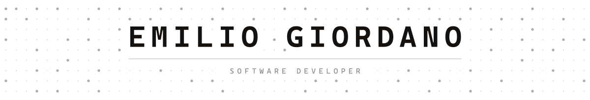
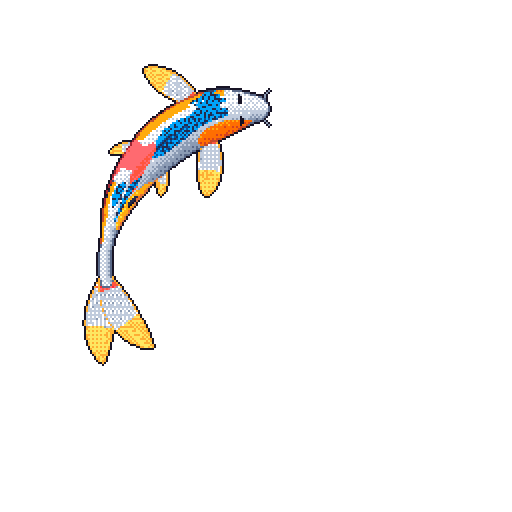
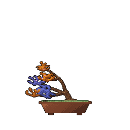

<!-- GitHub proxies these through camo and caches them hard. After changing a
     banner, bump ?v= or the old image keeps being served from the same URL. -->

  <picture>
    <source media="(prefers-color-scheme: dark)" srcset="https://raw.githubusercontent.com/EmilioGiordano/EmilioGiordano/main/assets/banner-dark.svg?v=2">
    
  </picture>

Software engineer working on backend systems and AI tooling, based in Buenos Aires.

Finishing my Bachelor's in Computer Science at [UNSAdA](https://www.unsada.edu.ar/).

<!-- Each anchor is kept on one line with no whitespace inside it: a newline in
     there renders as a linked space and GitHub underlines it between the chips. -->

<a href="https://giordanoemilio.vercel.app/"><picture><source media="(prefers-color-scheme: dark)" srcset="https://raw.githubusercontent.com/EmilioGiordano/EmilioGiordano/main/assets/portfolio-dark.svg?v=2"></picture></a>
<a href="https://www.linkedin.com/in/emilio-giordano/"><picture><source media="(prefers-color-scheme: dark)" srcset="https://raw.githubusercontent.com/EmilioGiordano/EmilioGiordano/main/assets/linkedin-dark.svg?v=2"></picture></a>
<a href="mailto:giordanoemilio21@gmail.com"><picture><source media="(prefers-color-scheme: dark)" srcset="https://raw.githubusercontent.com/EmilioGiordano/EmilioGiordano/main/assets/email-dark.svg?v=2"></picture></a>

## Things I've built

**[Zenkai](https://github.com/EmilioGiordano/Zenkai)**: a native spreadsheet built from scratch in Rust, for files too large or too messy for the usual tools. It reads and saves `.xlsx`, and a docked chat runs your own coding agents on the open workbooks.
 Rust, GPUI, IronCalc, Agent Client Protocol

**[UNSAdA-MCP](https://unsadamcp.dev/)**: lets AI agents read my university's Moodle, which has no usable API. Read-only by design, published on [npm](https://www.npmjs.com/package/unsada-mcp), and it shrinks a full course from about 830k tokens of HTML to 5k of JSON.
 TypeScript, Model Context Protocol, Playwright. [Code](https://github.com/EmilioGiordano/unsada-mcp)

**[CodeGraph](https://github.com/EmilioGiordano/basegraph)**: indexes a codebase into a ranked symbol graph, so an agent can orient itself in a few hundred tokens instead of reading whole files.
 Rust, petgraph, PageRank, Model Context Protocol

**[DocGen](https://github.com/EmilioGiordano/docgen)**: reduces Make.com blueprint exports to clean JSON for LLM analysis, with complexity stats and ready-to-use prompts for documenting and auditing them.
 Python, FastAPI, jq

**OpenLifting**: squat technique and muscle imbalance analysis from surface EMG, developed as my thesis project. A native Android app computes the metrics and syncs them to a Laravel API.
 Kotlin, Jetpack Compose, Laravel, PostgreSQL. [App](https://github.com/EmilioGiordano/OpenLifting-Mobile), [API](https://github.com/EmilioGiordano/Vortex)

**[LEGO Gallery](https://legogallery.vercel.app/)**: a browser engine that replays LEGO models as assembly sequences, drawing thousands of bricks with instanced WebGL.
 Three.js, Python. [Code](https://github.com/EmilioGiordano/lego-gallery)

Also: a [CABA rental dashboard](https://dashboard-cvd-unsada.vercel.app/), a [Sieve of Eratosthenes benchmark](https://criba-expo.netlify.app/) across five implementations, and a [Cisco commands cheat sheet](https://emiliogiordano.github.io/Hoja-de-Trucos-Cisco-Packet-Tracer/) (in Spanish).

<!-- Both images are redrawn and committed by the workflows in .github/workflows.
     They don't exist until those workflows have run once on GitHub. -->

 

The dots behind the banner are numbered left to right; the larger ones are the primes. <a href="https://github.com/EmilioGiordano/EmilioGiordano/blob/main/assets/banner.py">Generated here</a>.
